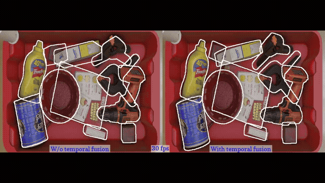

### Arul Selvam Periyasamy

**Robotic Perception Expert** at [Neura Robotics](https://www.neura-robotics.com/). I work on perception and learning for **embodied systems**—connecting vision, language, and action on real platforms.

**Now:** vision–language–action (VLA) models, multimodal scene understanding, and perception stacks for manipulation and human–robot interaction.

**Earlier work** (still part of how I build systems): multi-object **6D pose** estimation and tracking, synthetic data, and competition-scale autonomous manipulation (**Team NimbRo** / **NimbRo Picking**).

**Background:** Ph.D., University of Bonn (Autonomous Intelligent Systems); research scientist in edge computing, Siemens AG.

**Topics:** VLA · embodied AI · 3D perception · real-time inference · ROS / edge deployment

#### Snapshot

Short clip illustrating earlier research output (placeholder until an updated showreel).

[Publications & CV](https://selvamarul.github.io/) · [LinkedIn](https://www.linkedin.com/in/arulselvamperiyasamy)